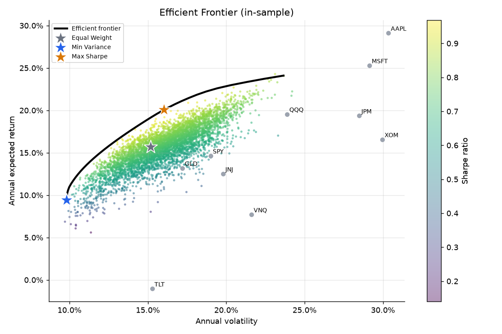
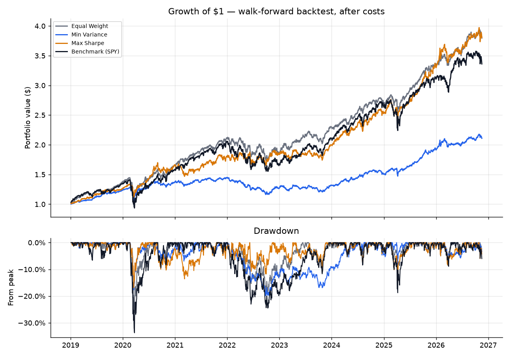
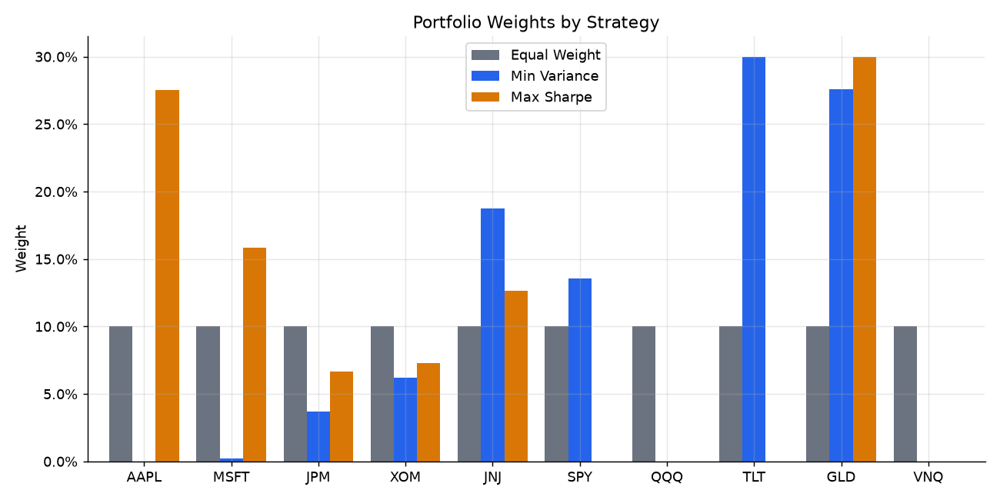

# Quantitative Portfolio Optimization Engine

A Python engine that builds and stress-tests stock/ETF portfolios with **Modern Portfolio Theory**, then checks whether the "optimal" portfolio still holds up in a **walk-forward, out-of-sample backtest after transaction costs**.

> **Question:** Does mean-variance optimization beat a simple equal-weight portfolio and the S&P 500 once you remove hindsight and pay trading costs?



## What it does

| Step | Detail |
|---|---|
| Data | Adjusted daily prices for 10 stocks & ETFs (AAPL, MSFT, JPM, XOM, JNJ, SPY, QQQ, TLT, GLD, VNQ) from Yahoo Finance, cached locally |
| Risk metrics | Annual return (CAGR), volatility, **Sharpe**, Sortino, **beta** vs. SPY, **maximum drawdown**, Calmar |
| Portfolios | **Equal-weight**, **minimum-variance**, **maximum-Sharpe** (long-only, 30% cap per asset) |
| MPT | **Efficient frontier** + 5,000 random portfolios for comparison |
| Backtest | Walk-forward: re-optimize quarterly using only the prior 252 trading days, 10 bps cost on turnover |
| Output | CSV tables, a written summary, interactive Plotly charts, and static PNGs |

## Results

<!-- RESULTS:START -->
_Out-of-sample walk-forward backtest, after 10 bps costs, Jan 2019 to Nov 2026. Full detail: [results/summary.md](results/summary.md)._

|                 | Annual Return   | Annual Volatility   |   Sharpe | Max Drawdown   |   Beta |
|:----------------|:----------------|:--------------------|---------:|:---------------|-------:|
| Equal Weight    | 18.5%           | 14.9%               |     0.94 | -26.2%         |   0.73 |
| Min Variance    | 10.0%           | 10.0%               |     0.6  | -19.9%         |   0.31 |
| Max Sharpe      | 18.5%           | 14.5%               |     0.97 | -16.9%         |   0.54 |
| Benchmark (SPY) | 16.7%           | 19.2%               |     0.69 | -33.7%         |   1    |

**Key findings**

- Best out-of-sample Sharpe: **Max Sharpe** (0.97).
- Shallowest max drawdown: **Max Sharpe** (-16.9%).
- Max Sharpe (full period) concentrates in GLD 30.0%, AAPL 27.5%, MSFT 15.9%.
- Sharpe, in-sample → out-of-sample: Equal Weight 0.77 → 0.94, Min Variance 0.56 → 0.60, Max Sharpe 1.00 → 0.97. Max Sharpe held up out-of-sample, so its edge was not just hindsight. (The backtest starts after the first lookback window, so the periods differ slightly.)
<!-- RESULTS:END -->





## How it works

**Max Sharpe** solves

$$\max_w \frac{w^\top\mu - r_f}{\sqrt{w^\top \Sigma w}} \quad \text{s.t.} \quad \sum w_i = 1,\; 0 \le w_i \le 0.30$$

where μ is the annualized mean return and Σ the annualized covariance matrix. **Min variance** minimizes wᵀΣw under the same constraints. The **efficient frontier** is traced by minimizing variance for a range of target returns. All optimizations use SciPy's SLSQP solver.

**Why the walk-forward backtest matters:** weights optimized on the full history are judged on the same data that produced them — that's look-ahead bias, and it flatters the optimizer. The backtest re-optimizes every 63 trading days using only past data, lets weights drift between rebalances, and charges costs on turnover. Comparing in-sample vs. out-of-sample Sharpe shows how much of the "optimal" result was hindsight.

## Project structure

```
├── main.py                  # runs the full pipeline (CLI)
├── src/portfolio_engine/
│   ├── data.py              # Yahoo Finance download + cache, demo data
│   ├── metrics.py           # Sharpe, Sortino, beta, drawdown, CAGR
│   ├── optimizer.py         # min-variance, max-Sharpe, efficient frontier
│   ├── backtest.py          # walk-forward out-of-sample backtest
│   └── visuals.py           # Plotly HTML + Matplotlib PNG charts
├── notebooks/               # step-by-step walkthrough
├── tests/                   # pytest unit tests
├── data/                    # cached prices (created on first run)
├── results/                 # CSV metrics, weights, summary.md
└── visuals/                 # charts (.png for README, .html interactive)
```

## Run it

```bash
python -m venv .venv
# Windows: .venv\Scripts\activate    macOS/Linux: source .venv/bin/activate
pip install -r requirements.txt
python main.py
```

Options:

```bash
python main.py --tickers AAPL MSFT NVDA JPM TLT GLD --start 2019-01-01 --max-weight 0.35
python main.py --rf 0.045 --rebalance 21 --cost-bps 5     # monthly rebalance, 4.5% risk-free
python main.py --demo                                     # synthetic data, no internet (testing only)
python -m pytest                                          # run the tests
```

Open any `visuals/*.html` file in a browser for interactive charts.

## Limitations

- **Estimation error:** historical mean returns are noisy predictors of future returns; max-Sharpe portfolios are very sensitive to them and tend to concentrate in recent winners.
- **Survivorship bias:** the universe is today's well-known names, chosen with hindsight.
- **Constant risk-free rate:** a single 4% rate is used across the whole period rather than the actual T-bill history.
- **Simplified costs:** a flat basis-point charge on turnover; no bid-ask spread modeling, slippage, taxes, or market impact.
- **Normal-world risk measures:** volatility treats upside and downside alike and understates fat-tail risk (see Sortino and max drawdown).
- **Data source:** Yahoo Finance is free, not institutional-grade.

## Next steps

- Covariance shrinkage (Ledoit-Wolf) and Black-Litterman expected returns
- Risk-parity and hierarchical risk parity portfolios
- Historical T-bill rates from FRED for the risk-free rate
- Streamlit dashboard for choosing tickers interactively

## Tech

Python · pandas · NumPy · SciPy · yfinance · Plotly · Matplotlib · pytest

---
*Educational project, not investment advice.*
